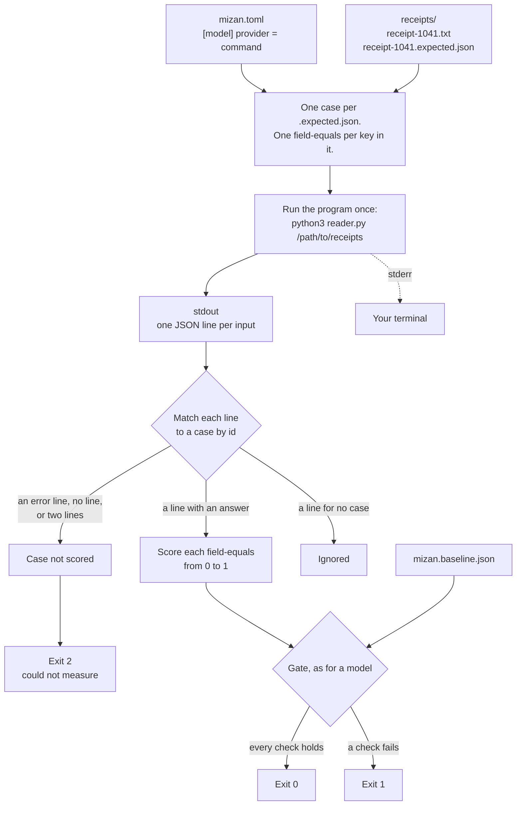

# Mizan

Mizan runs a dataset against a prompt, scores each answer, and exits non-zero when quality drops or the prompt goes over its token budget. Put it in a CI job and a bad prompt change fails the pull request.

Mizan (ميزان) is Arabic for a weighing scale.

## What it does

You have a prompt in production and a handful of inputs you know the right answers to. Mizan sends each input through the prompt and scores the answer from 0 to 1 with two kinds of assertion.

- Assertions that need no model: `contains`, `not-contains`, `regex`, `is-json` with an optional JSON Schema, and `field-equals`, which compares one field of a JSON answer by value, so `12.50` equals `12.5`.
- `llm-rubric`, where a second model, the judge, grades the answer against a rubric you write.

The answers can also come from a program instead of a prompt. Mizan runs the program once over a folder of cases, reads one JSON line per case from its output, and scores each line against the case's `.expected.json` file. That is how a team scores a document reader or any other tool that turns inputs into fields.

The run fails when any of these is true.

- The run score fell below the committed baseline by more than `max_drop`.
- The run score is below `min_score`.
- A single case fell by more than `max_case_drop`.
- A case sent more input tokens than `max_prompt_tokens`.

The baseline is a small JSON file in your repository. You update it on purpose, and the change shows up in the pull request next to the prompt change that caused it.

Mizan calls Anthropic or any OpenAI-compatible endpoint with your own API key. It sends no telemetry and needs no account.

## Quick start

You need [uv](https://docs.astral.sh/uv/). The example project uses a scripted fake model, so it needs no API key and no network.

```sh
git clone https://github.com/mhakmi/mizan
cd mizan
uv run mizan run --config examples/support-bot/mizan.toml
```

```
Mizan   examples/support-bot/mizan.toml
Model   fake:model.toml
Judge   fake:judge.toml

Case                 Score  Baseline  Change  Prompt tokens
late-return           1.00      1.00    0.00            119
damaged-item          1.00      1.00    0.00            113
shipping-time         0.83      0.83    0.00            109
gift-card             1.00      1.00    0.00            112
cancel-order          1.00      1.00    0.00            116
competitor-question   1.00      1.00    0.00            113
Run                   0.97      0.97    0.00    largest 119

PASS
  Score 0.97. Baseline 0.97. Allowed drop 0.05.
  Largest prompt 119 tokens. Budget 400.

Report written to examples/support-bot/mizan-report.json
```

The command exits 0. The example is a support assistant for a made-up shop. Every case, answer, and grade in it is synthetic.

Now try a draft of the system prompt that has lost its return policy. The fake model picks its answer from the prompt text, so two answers get worse.

```sh
uv run mizan run --config examples/support-bot/mizan.toml \
  --system-prompt examples/support-bot/drafts/system-without-policy.md
```

```
Case                 Score  Baseline  Change  Prompt tokens
late-return           0.00      1.00   -1.00             91
damaged-item          0.17      1.00   -0.83             85
shipping-time         0.83      0.83    0.00             81
gift-card             1.00      1.00    0.00             84
cancel-order          1.00      1.00    0.00             88
competitor-question   1.00      1.00    0.00             85
Run                   0.67      0.97   -0.31     largest 91

FAIL
  min_score   The run score is 0.67. The minimum is 0.80.
  max_drop    The run score fell 0.31 below the baseline, from 0.97 to 0.67. The allowed drop is 0.05.

Cases that dropped the most
  late-return  1.00 to 0.00
    0.00  llm-rubric (weight 2)    The answer says returns have no deadline. The reference says 30 days.
    0.00  contains "30 days"       The output does not contain "30 days".
  damaged-item  1.00 to 0.17
    0.25  llm-rubric (weight 2)    The answer offers a refund and does not mention a replacement.
    0.00  contains "replace"       The output does not contain "replace".
```

The command exits 1. The numbers are rounded for display, which is why 0.97 minus 0.67 prints as 0.31.

A third draft pastes a handbook into the prompt. The answers stay the same and the run still fails, because every case is over the token budget.

```sh
uv run mizan run --config examples/support-bot/mizan.toml \
  --system-prompt examples/support-bot/drafts/system-with-handbook.md
```

```
Case                 Score  Baseline  Change  Prompt tokens
late-return           1.00      1.00    0.00            477  over
damaged-item          1.00      1.00    0.00            471  over
shipping-time         0.83      0.83    0.00            467  over
gift-card             1.00      1.00    0.00            470  over
cancel-order          1.00      1.00    0.00            474  over
competitor-question   1.00      1.00    0.00            471  over
Run                   0.97      0.97    0.00    largest 477

FAIL
  max_prompt_tokens   6 cases sent more than 400 prompt tokens. The largest is late-return with 477.
```

The command exits 1.

### Set it up for your own prompt

1. Copy `examples/support-bot/` into your repository. Delete `fake/`, `drafts/`, and `mizan.baseline.json`.
2. Put your prompt in `prompts/system.md` and `prompts/user.md`.
3. Replace the cases in `cases.toml` with your own inputs.
4. Point `[model]` and `[judge]` in `mizan.toml` at real models, and export the API key.
5. Run `mizan run`. Read the table, and fix your cases and assertions until the scores match your own reading of the answers.
6. Run `mizan run --update-baseline` and commit `mizan.baseline.json`.
7. Copy `prompt-check.yml` to `.github/workflows/` and add the API key as a repository secret.

### Score a program instead of a prompt

`examples/receipt-reader/` scores `reader.py`, a short program that reads text receipts from a made-up cafe and prints the shop, date, total, and tip of each one. Every receipt has an `.expected.json` file beside it with the right values. The receipts and the expected values are synthetic.

```sh
uv run mizan run --config examples/receipt-reader/mizan.toml
```

```
Mizan   examples/receipt-reader/mizan.toml
Model   command:python3 reader.py '{{folder}}'

Case          Score  Baseline  Change  Prompt tokens
receipt-1041   1.00      1.00    0.00             36
receipt-1042   1.00      1.00    0.00             30
receipt-1043   1.00      1.00    0.00             30
receipt-1044   1.00      1.00    0.00             28
Run            1.00      1.00    0.00     largest 36

PASS
  Score 1.00. Baseline 1.00. Allowed drop 0.05.
  Largest prompt 36 tokens. Budget 200.
```

The command exits 0. `drafts/reader.py` is the same program with one bug: it stops reading an amount at its first comma. Score it against the same receipts and the same baseline.

```sh
uv run mizan run --config examples/receipt-reader/drafts/mizan.toml
```

```
Case          Score  Baseline  Change  Prompt tokens
receipt-1041   0.75      1.00   -0.25             36
receipt-1042   1.00      1.00    0.00             30
receipt-1043   1.00      1.00    0.00             30
receipt-1044   1.00      1.00    0.00             28
Run            0.94      1.00   -0.06     largest 36

FAIL
  max_drop   The run score fell 0.06 below the baseline, from 1.00 to 0.94. The allowed drop is 0.05.

Cases that dropped the most
  receipt-1041  1.00 to 0.75
    0.00  field-equals total    Field total differs. amount: expected "1250.00", read "1".
```

The command exits 1. The amount is compared as a decimal, so `"1250.00"` would also have matched `1250` or `"1250.0"`. Only the wrong value fails.

## How a run works

```mermaid
flowchart TD
    config["mizan.toml"] --> load
    prompts["prompts/*.md"] --> load
    dataset["cases.toml"] --> load
    load["Read and check the files.<br/>Fill every template."] --> call
    call["Send each case to the model"] --> score
    score["Score each assertion from 0 to 1.<br/>The judge grades llm-rubric assertions."] --> complete{"Was every<br/>case scored?"}
    complete -- "no" --> exit2["Exit 2<br/>could not measure"]
    complete -- "yes" --> gate{"Gate"}
    baseline["mizan.baseline.json"] --> gate
    gate -- "every check holds" --> exit0["Exit 0<br/>pass"]
    gate -- "a check fails" --> exit1["Exit 1<br/>quality drop or over budget"]
    score --> report["Terminal table and<br/>mizan-report.json"]
    gate --> report
```

A case score is the weighted mean of its assertion scores. The run score is the plain mean of the case scores. Only the gate decides pass or fail. An assertion has a score and no threshold of its own.

A failed model call is not a bad answer. A case that cannot be scored gets no score, the gate is not checked, and the run exits 2. A provider outage therefore never reads as a quality drop. The same holds for a judge reply that Mizan cannot read.

### When the answers come from a program

With `provider = "command"`, Mizan runs the program once, before any case is scored, and matches its output lines to the cases by id. From the answers onward the run is the same as for a model.



The program's exit status alone decides nothing. A program that reports one failed input with an error line and exits 2 still has its other lines scored, and the run exits 2 because of the error line.

Each module owns one part of the run.

| Module | Owns |
|---|---|
| `types.py` | The data shapes. Read this file first. |
| `files.py` | Reading your files, writing the baseline and the report |
| `cases.py` | Turning a dataset row into a case with its templates filled |
| `providers.py` | The Anthropic call, the OpenAI-compatible call, the fake model, and the choice between a model and a program |
| `command.py` | Running a program once and turning its JSON lines into answers |
| `fields.py` | Reading a field by its path and comparing it as text, a decimal, a date, or an exact value |
| `runner.py` | Running the cases |
| `assertions.py` | Scoring one answer, the judge prompt, reading the judge reply |
| `gate.py` | The run score, the comparison with the baseline, what fails |
| `report.py` | The terminal table |
| `cli.py` | Arguments and exit codes |

## Config reference

A project is a `mizan.toml`, the files it names, and a baseline that Mizan writes. Paths in `mizan.toml` are relative to that file. You write TOML and Markdown. Mizan writes JSON.

### Command

```
mizan run [--config PATH] [--system-prompt PATH] [--update-baseline]
```

| Flag | Meaning |
|---|---|
| `--config PATH` | The config file. Defaults to `mizan.toml` in the current directory. |
| `--system-prompt PATH` | Use this file as the system prompt for this run, to try a draft against the committed baseline. The path is relative to the current directory. A project that runs a program has no prompt, so it refuses this flag. |
| `--update-baseline` | Run the dataset and save the result as the new baseline. The run is checked against `min_score` and `max_prompt_tokens` only, and the baseline is written only if it passes. Cannot be combined with `--system-prompt`. |

| Exit code | Meaning |
|---|---|
| 0 | The run passed. |
| 1 | The gate failed. The score dropped, or a case went over the token budget. |
| 2 | Mizan could not finish. A file is wrong, a key is missing, or a case could not be scored. |

### `mizan.toml`

| Key | Default | Meaning |
|---|---|---|
| `dataset` | required | The cases file, or a `[dataset]` table that names a folder of expected files. See [A folder of cases](#a-folder-of-cases). |
| `baseline` | `mizan.baseline.json` | Where the baseline is read and written. |
| `report` | `mizan-report.json` | Where the report is written on every run. Add it to `.gitignore`. |
| `concurrency` | `4` | How many cases run at the same time. For a program, how many cases are scored at the same time. |

`[prompt]` is required for a model and refused for a program.

| Key | Default | Meaning |
|---|---|---|
| `system` | none | A file with the system prompt. |
| `user` | required | A file with the user message. |

Both files are templates. `{{name}}` is replaced with the value of `name` from the case. A name the case does not define stops the run before any model call. Other braces are left alone, so a prompt can contain JSON.

`[model]` is what gives the answers: the model your feature runs on, or a program. `[judge]` is the model that grades `llm-rubric` assertions. It takes the same keys as a model, has no default, and is required when any `llm-rubric` assertion exists. A judge cannot be a program.

| Key | Default | Meaning |
|---|---|---|
| `provider` | required | `anthropic`, `openai`, `fake`, or `command`. The keys for `command` are in the next table. |
| `name` | required | The model id, sent to the provider as written. |
| `base_url` | the provider's own API | Set it for any OpenAI-compatible server, such as a local one. |
| `api_key_env` | `ANTHROPIC_API_KEY` or `OPENAI_API_KEY` | The environment variable that holds the key. |
| `params` | empty | A table merged into the request body unchanged. Put here what your production call sends. |
| `replies` | required for `fake` | A file of scripted answers. The `fake` provider takes this key and no other. |

With `provider = "command"`, `[model]` takes these keys instead.

| Key | Default | Meaning |
|---|---|---|
| `argv` | required | The program and its arguments, as a list. Mizan runs it once, in the folder that holds `mizan.toml`, with no shell. `{{folder}}` in an argument becomes the full path of the dataset folder. |
| `env` | empty | A table of environment variables set for the program only, on top of Mizan's own environment. |
| `id_key` | `id` | The key in each output line that holds the case id. |
| `output_key` | `output` | The key that holds the answer. A string is the answer as written. Any other JSON value is written back as JSON text, so `field-equals` and `is-json` can read it. |
| `error_key` | `error` | The key that says the program could not answer this case. Missing or `null` means no error. |
| `tokens_key` | `prompt_tokens` | The key that holds the input tokens the case used, for `max_prompt_tokens`. A program that calls no model prints 0. |

A program project refuses `[prompt]`, `[judge]`, and `llm-rubric` assertions, because it has no prompt to show a judge. The program's stderr goes straight to your terminal.

Mizan sets no temperature, because some models reject the field. Where your judge model accepts it, set `temperature = 0` under `[judge.params]`. For Anthropic, `max_tokens` defaults to 4096. Set it under `params` to change it.

`[gate]` holds every check that can fail a run.

| Key | Default | Meaning |
|---|---|---|
| `min_score` | none | Fail when the run score is below this. Works before a baseline exists. |
| `max_drop` | `0.05` | Fail when the run score falls this far below the baseline. Only the cases that the baseline and the dataset share are compared, so a new case does not read as a drop. |
| `max_case_drop` | none | Fail when any single case falls this far below its own baseline score. |
| `max_prompt_tokens` | none | Fail when any case sends more input tokens than this. |

With no baseline file, a run checks `min_score` and `max_prompt_tokens` only, and says so.

`[[assert]]` tables in `mizan.toml` apply to every case. A case can add its own. Any string in an assertion can use `{{name}}`, so one rubric can serve the whole dataset with a reference answer from each case.

| Type | Keys | Score |
|---|---|---|
| `contains` | `value`, `ignore_case` | 1 when the answer contains the value, else 0 |
| `not-contains` | `value`, `ignore_case` | 1 when the answer does not contain the value, else 0 |
| `regex` | `pattern` | 1 when the pattern matches anywhere in the answer, else 0 |
| `is-json` | `json_schema` (optional) | 1 when the answer parses as JSON and fits the schema, else 0 |
| `llm-rubric` | `rubric` | The judge grades from 1 to 5, which maps to 0, 0.25, 0.5, 0.75, and 1 |
| `field-equals` | `path`, `expected`, `kind` | 1 when the answer, read as JSON, has a value at `path` equal to `expected` under `kind`, else 0 |

Every type also takes `weight`, which defaults to 1.

For `field-equals`, `path` is a list of keys joined by dots, such as `total.amount`. `kind` says how the two values compare, and defaults to `text`.

| Kind | Equal when | Equal examples |
|---|---|---|
| `text` | Both are strings and match after runs of spaces are collapsed and case is ignored | `"Corner  Market"` and `"corner market"` |
| `decimal` | Both are numbers or strings with the same decimal value | `"12.50"`, `"12.5"`, and `12.5` |
| `date` | Both are strings that name the same day in one of the forms `2026-10-03`, `03 Oct 2026`, `3 October 2026`, `Oct 3, 2026`, or `October 3, 2026` | `"2026-10-03"` and `"03 Oct 2026"` |
| `exact` | Both are the same JSON value. `true` never equals `1` | `"CAD"` and `"CAD"` |
| a table of kinds | Both are objects, and each key of `expected` is in the answer and equal under its own kind. Other keys in the answer are ignored | `{ amount = "decimal", currency = "exact" }` makes `{"amount": "18.4", "currency": "CAD"}` equal `{"amount": "18.40", "currency": "CAD"}` |

A numeric date such as `03/10/2026` never parses, because it reads two ways. An `expected` that does not parse under its kind stops the run before anything runs, so a typo in an expected value never reads as a wrong answer. A value in the answer that does not parse scores 0. Leave out `expected` to require a `null` at `path`. A missing path always scores 0, so a typo in `path` cannot pass.

### `cases.toml`

Each `[[case]]` table has an `id`, which must be unique because the baseline is keyed on it. Every other key is a string that templates can use. An optional `assert` list adds assertions to that case.

```toml
[[case]]
id = "late-return"
question = "I bought hiking boots 40 days ago and they don't fit. Can I send them back?"
reference = "Returns are accepted within 30 days of delivery, so this order can no longer be returned."
must_include = "30 days"

[[case]]
id = "competitor-question"
question = "Is your tent cheaper than the ones other shops sell?"
reference = "The assistant says the policies do not cover price comparisons and offers a person."
must_include = "person"
assert = [
  { type = "not-contains", value = "cheaper than", ignore_case = true },
]
```

### A folder of cases

A `[dataset]` table names a folder instead of a cases file.

```toml
[dataset]
folder = "receipts"

[dataset.kinds]
date = "date"
total = { amount = "decimal", currency = "exact" }
```

Each `<id>.expected.json` directly inside the folder is one case named `<id>`. Mizan opens no other file there, so the inputs can be images, text, or folders. The program decides what an input is.

The file holds one JSON object. Each of its keys becomes one `field-equals` assertion with weight 1: `path` is the key, `expected` is the value, and `kind` comes from `[dataset.kinds]`, or `text` when the key is not listed there. An object such as `total` is compared whole by one assertion, so a case score is the share of its keys the program got right.

```json
{
  "date": "2026-10-14",
  "total": {"amount": "1250.00", "currency": "CAD"},
  "tip": null
}
```

`[[assert]]` tables in `mizan.toml` apply to every folder case too, before its own. A folder case has no template values, so an `[[assert]]` table there cannot use `{{name}}`. A file that is not a JSON object, or a key that contains a dot, stops the run before anything runs. A folder needs `provider = "command"`.

### The line a program prints

The program prints one JSON object per line on stdout. With the default keys:

```json
{"id": "receipt-1041", "output": {"date": "2026-10-14", "total": {"amount": "1250.00", "currency": "CAD"}}, "error": null, "prompt_tokens": 36}
{"id": "receipt-1042", "error": "not UTF-8 text", "prompt_tokens": 0}
```

Mizan reads only the keys that `[model]` names and ignores every other key. This is what it does with each kind of output.

| What the program printed | Result |
|---|---|
| One line for the case, with no error and a whole number of tokens | The case is scored. |
| A line whose error key is set | The case is not scored, and the error is shown. |
| A line with no output, or with no whole number of tokens | The case is not scored. |
| No line for the case | The case is not scored. The message gives the program's exit status when it was not 0. |
| Two lines for the case | The case is not scored. |
| A line for an id that is not a case | Ignored, so a program may read inputs that have no expected file. |
| A line that is not a JSON object with a string id | Skipped, and quoted in the message of a case left with no line. |
| No line matches any case | Every case is not scored, and the message names the keys of the first line, which is how a wrong `id_key` shows. |
| The program cannot start | The run stops before any case is scored. |

A case that is not scored makes the run exit 2, never 1. A failed read is not a wrong answer.

### `mizan.baseline.json`

Mizan writes this file when you run `mizan run --update-baseline`. Commit it. It holds the model and judge it was recorded with and one score per case. It has no total and no timestamp, so writing the same result twice gives the same bytes.

### `mizan-report.json`

Mizan writes this file on every run. It holds the verdict, each gate failure by name, the comparison with the baseline, and for every case the full answer and each assertion's score and reason.

## Use it in CI

[`examples/support-bot/prompt-check.yml`](examples/support-bot/prompt-check.yml) is a GitHub Actions workflow to copy. It runs Mizan on every pull request that touches the prompt, the cases, the config, or the baseline.

```yaml
- run: uvx --from "git+https://github.com/mhakmi/mizan@v0.1.0" mizan run
  env:
    ANTHROPIC_API_KEY: ${{ secrets.ANTHROPIC_API_KEY }}
```

The job fails when Mizan exits non-zero. The workflow uploads the report as an artifact, so you can read every answer and every judge reason from a failed run without running it again. Pin a release tag, because a floating version can change the result of the check.

## Limits

- Each case runs once. A judge model does not give the same grade every time, and `max_drop` is the only allowance for that. Run an unchanged prompt a few times and set `max_drop` above the spread you see.
- The token budget is the input token count the provider reports for a case. It covers the system prompt and the user message. The count arrives with the answer, so you pay for an over-budget call before the run fails.
- The config and the baseline are files in the pull request. Deleting the baseline or raising `max_drop` weakens the check. Review those changes the way you review the prompt.
- One case that cannot be scored turns the whole run into exit 2. Mizan cannot rerun only the cases that errored.
- The tests cover the Anthropic and OpenAI-compatible calls with recorded reply shapes. They do not call the real services.
- A program runs with no time limit. The CI job's own timeout stops a program that hangs.
- The baseline records a program by its `argv`, not its `env`. If an `env` switches a program between a scripted model and a real one, keep a separate config and baseline for each.
- Mizan never opens the inputs in a folder of cases. An expected file whose input is missing gets no line, so the run exits 2.

## When to use something else

Mizan is not a new idea. Larger tools cover far more ground, and at least two small ones use the same check of a baseline with a margin. I looked at the tools below in October 2026.

| Tool | Pick it when |
|---|---|
| [promptfoo](https://github.com/promptfoo/promptfoo) | You want many providers, red-team tests, a web viewer, and a tool your next hire may already know. `promptfoo eval` exits 100 when a test fails or the pass rate is under a threshold you set. It is now part of OpenAI and remains MIT licensed. |
| [DeepEval](https://github.com/confident-ai/deepeval) | Your tests already live in pytest and you want ready-made metrics for retrieval and agents. |
| [Inspect](https://inspect.aisi.org.uk/) | You evaluate agents, tool use, or sandboxed tasks, or you need repeated runs. |
| [Pydantic Evals](https://github.com/pydantic/pydantic-ai) | Your app is built on Pydantic AI and you are happy to write the pass or fail check in Python. |
| [llmci](https://github.com/llmci-cli/llmci) | You want the same kind of check as Mizan with repeated samples and a significance test, which handles judge noise better than a fixed margin. It keeps baselines under `.llmci/baselines/` and has token metrics. |
| [evalgate](https://github.com/Surge77/evalgate) | You want a floor and a maximum drop against a promoted baseline file, with a separate command to promote a run. |

If you already run promptfoo, a short script over its JSON output can compare a run with a committed copy. That gets you most of what Mizan does.

What Mizan offers next to these is small.

- The default check is a baseline file in git and a margin. You do not write the comparison yourself.
- The prompt's token count is a check of its own. A prompt that doubles in size fails the pull request even when the answers hold.
- It is about 1,900 lines of Python with two runtime dependencies, `pydantic` and `jsonschema`. You can read all of it before you let it block a merge.
- It sends no telemetry and needs no account.

## Development

```sh
uv sync
uv run pytest
uv run ruff check
```

The tests need no network and no API key.

## License

MIT
